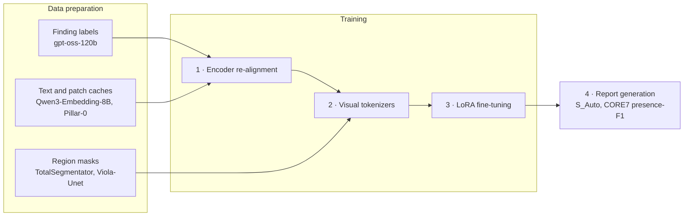

<h1 align="center">[MICCAI'26] Finding-Aware Head CT Report Generation</h1>

<p align="center">
Contrastive re-alignment of a head CT encoder with radiology reports,<br>
and a LoRA-tuned report generator built on top of it
</p>

<p align="center">
<a href="#citation"></a>
<a href="#citation"></a>
<a href="LICENSE"></a>

</p>

<p align="center">
<a href="#method">Method</a> ·
<a href="#results">Results</a> ·
<a href="#installation">Installation</a> ·
<a href="#data">Data</a> ·
<a href="#training">Training</a> ·
<a href="#evaluation">Evaluation</a> ·
<a href="docs/DATA.md">Data preparation</a> ·
<a href="#citation">Citation</a>
</p>


## Overview

This repository contains the code for the paper
*Finding-Aware Contrastive Re-Alignment for Head CT Report Generation*
(MICCAI 2026 Satellite Events, Lecture Notes in Computer Science), our
2nd-place system in the MICCAI 2026 HEADLINE Challenge. HEADLINE asks for
the free-text report of a non-contrast head CT study, a Findings narrative
and an Assessment, as a radiologist would write it.

Clinically important head CT findings are often small and low-contrast, and
a language model cannot report a finding that the visual encoder has failed
to represent. We therefore adapt the encoder to head CT reports before
training the generator. The repository covers:

* realigning a pretrained head CT encoder with radiology reports;
* training visual tokenization modules for report generation;
* fine-tuning Qwen2.5-7B-Instruct with LoRA; and
* evaluating generated reports using S_Auto and CORE7 presence-F1.

## Method

**(a) Contrastive re-alignment of the encoder.** The general-CT encoder
Pillar-0 is re-aligned to the reports with three objectives, combined as
`L = L_global + 0.3 · L_local + 0.5 · L_presence`:

| Objective | What it aligns |
|---|---|
| Global study–report alignment | SigLIP-style loss between the study embedding and its report embedding; reports with similar finding-presence vectors count as positives |
| Local patch–finding alignment | Image patches against the individual sentences of the Findings section |
| Finding-presence supervision | Class-balanced BCE on 20 finding labels extracted from the report |

Report and finding-statement embeddings come from a frozen
Qwen3-Embedding-8B; finding labels are extracted from the free-text reports
with gpt-oss-120b. Seven of the 20 labels (CORE7: hemorrhage, infarct,
fracture, mass, mass effect, midline shift, hydrocephalus) are used for
evaluation.

**(b) Report generation.** The re-aligned encoder is frozen. Its features
pass through a global tokenizer (a Perceiver-style resampler across all
scales) and a region tokenizer that mean-pools features within 18 region
masks derived from TotalSegmentator and Viola-Unet. The resulting visual tokens and the task
prompt are fed to Qwen2.5-7B-Instruct with LoRA.



## Results

All numbers are on a 600-study internal validation split of the HEADLINE
training data (paper Tables 1 and 2), not on the challenge test set.

**Encoder-level finding discrimination.** The baseline Pillar-0 encoder and
the re-aligned encoder are compared with an identical classifier head;
F1 is reported at the per-finding optimal threshold, and *n* is the number
of positive studies.

| Finding | *n* | AUROC (baseline) | AUROC (re-aligned) | F1 (baseline) | F1 (re-aligned) |
|---|---:|---:|---:|---:|---:|
| Hemorrhage | 203 | 0.862 | **0.908** | 0.727 | **0.805** |
| Infarct | 143 | 0.716 | **0.798** | 0.489 | **0.565** |
| Fracture | 24 | 0.789 | **0.874** | 0.333 | **0.500** |
| Mass | 74 | 0.701 | **0.775** | 0.363 | **0.464** |
| Mass effect | 114 | 0.858 | **0.899** | 0.610 | **0.667** |
| Midline shift | 91 | 0.858 | **0.900** | 0.566 | **0.638** |
| Hydrocephalus | 24 | 0.791 | **0.837** | **0.308** | 0.300 |
| **Macro** | | 0.796 | **0.856** | 0.485 | **0.563** |

**Generated-report performance.** Replacing the baseline encoder with the
re-aligned one, with the generator configuration fixed:

| Encoder | S_Auto | Report presence-F1 |
|---|---:|---:|
| Baseline | 0.194 | 0.130 |
| Re-aligned | **0.210** | **0.328** |

S_Auto = 0.7 · BERTScore-F1 + 0.1 · (METEOR + ROUGE-L + BLEU-4). The report
presence-F1 compares the seven core findings extracted from the generated
and reference reports and involves no threshold selection. It stays below
the encoder presence-F1 of the same representation (0.328 vs 0.563), which
points to a gap between what the encoder represents and what the generator
reports.

## Requirements

The complete pipeline requires one or more NVIDIA H100 GPUs (recommended).

The preprocessing tools have incompatible dependency requirements and should therefore be installed in isolated environments.

See [`env/README.md`](env/README.md) for environment-specific instructions.

## Installation

Install the main training and evaluation environment:

```bash
uv sync
```

FlashAttention is optional:

```bash
uv pip install flash-attn --no-build-isolation
```

When FlashAttention is unavailable, the code falls back to PyTorch SDPA.

Install `rad-vision-engine`:

```bash
git clone --branch release \
  https://github.com/yalalab/rad-vision-engine

uv pip install -e rad-vision-engine
```

Additional isolated environments are required for:

* TotalSegmentator;
* Viola-Unet; and
* vLLM-based finding extraction.

See [`env/README.md`](env/README.md) for details.

## Data

Set `HEADLINE_DATA_ROOT` to the HEADLINE dataset directory:

```bash
export HEADLINE_DATA_ROOT=/path/to/headline
```

Using a symbolic link is also supported:

```bash
ln -s /path/to/headline ./data
```

The expected directory structure is:

```text
$HEADLINE_DATA_ROOT/
└── raw/
    ├── batch1/
    │   ├── CT_data/
    │   │   └── <PatientID>/
    │   │       └── <StudyID>/
    │   │           └── <reconstruction>/
    │   │               └── *.nii.gz
    │   └── reports_train_batch1.csv
    ├── batch2/
    └── batch3/
```

The pipeline uses only the soft-tissue reconstruction whose directory name begins with `WT`. Bone-kernel reconstructions beginning with `KF` are ignored.

All derived-data paths are managed through `src/headline/paths.py`.

See [`docs/DATA.md`](docs/DATA.md) for detailed preparation instructions and batch-specific report formats.

## External Checkpoints and Tools

The following models and external tools are required:

| Component                | Default location              | Purpose                                       |
| ------------------------ | ----------------------------- | --------------------------------------------- |
| Pillar-0 head CT encoder | `refs/pillar0_headct/`        | CT feature extraction and encoder realignment |
| Qwen2.5-7B-Instruct      | `models/qwen2.5-7b-instruct/` | Report generation                             |
| Qwen3-Embedding-8B       | `models/qwen3-embedding-8b/`  | Report embedding during encoder realignment   |
| gpt-oss-120b             | `models/gpt-oss-120b/`        | Finding extraction and evaluation             |
| TotalSegmentator         | Installed separately          | Anatomical region masks                       |
| Viola-Unet               | `third_party/violai/`         | Hemorrhage masks                              |

The Pillar-0 location can also be specified through an environment variable:

```bash
export HEADLINE_PILLAR0=/path/to/pillar0
```

Model and dataset licenses are not included in this repository. Some components require gated access or separate license approval.

See [`docs/DATA.md`](docs/DATA.md) for download instructions and license information.

## Data Preparation

### 1. Generate Region Masks

```bash
TS_PY=/path/to/totalsegmentator/python \
VIOLA_PY=/path/to/viola/python \
GPUS=0,1 \
bash scripts/prep/00_masks.sh
```

This step creates 18 region masks using TotalSegmentator and Viola-Unet.

### 2. Extract Structured Findings

```bash
VLLM_PY=/path/to/vllm/python \
GPU=0 \
bash scripts/prep/01_report_labels.sh
```

This step converts free-text reports into structured finding labels and prepares the stage-2 task mixture.

### 3. Build Caches

```bash
GPU=0 \
bash scripts/prep/02_caches.sh
```

This step creates:

* report embedding caches using Qwen3-Embedding-8B; and
* patch embedding caches using the frozen Pillar-0 patch embedding module.

## Training

### 1. Realign the CT Encoder

```bash
GPU=0 \
CACHE_GPUS=0,1 \
bash scripts/01_train_encoder.sh
```

### 2. Train the Visual Tokenization Modules

```bash
GPU=0 \
bash scripts/02_train_stage1.sh
```

### 3. Fine-Tune with LoRA

```bash
GPU=0 \
bash scripts/03_train_stage2.sh
```

```bash
bash scripts/03_train_stage2.sh --epochs 2
```

## Evaluation

Generate reports and compute the evaluation metrics:

```bash
GPU=0 \
VLLM_PY=/path/to/vllm/python \
bash scripts/04_eval.sh
```

Evaluation outputs are written to:

```text
runs/eval/generated.sauto.json
runs/eval/presence_f1.json
```

## Smoke Test

The main training entry points support `--limit N` for small development runs.

For example:

```bash
uv run python -m headline.train.reportgen \
  --config configs/stage1.json \
  --limit 64 \
  --out runs/smoke
```

Run the test suite with:

```bash
uv run pytest
```

The smoke test verifies the main data-loading and report-generation code paths without building the complete training caches.

## Documentation

* [`docs/DATA.md`](docs/DATA.md): dataset preparation, checkpoints, and licenses
* [`env/README.md`](env/README.md): isolated preprocessing environments

## Citation

```bibtex
@inproceedings{park2026headline,
  title     = {Finding-Aware Contrastive Re-Alignment for Head CT Report Generation},
  author    = {Park, Jinyong and Kim, Yong Soo and Jo, Nathan and Kim, Sejoong},
  booktitle = {Medical Image Computing and Computer Assisted Intervention --
               MICCAI 2026 Satellite Events},
  series    = {Lecture Notes in Computer Science},
  publisher = {Springer Nature Switzerland},
  year      = {2026}
}
```

Volume, page, and DOI information will be added once the proceedings are published.

## License

Code is released under the [Apache License 2.0](LICENSE). The HEADLINE
dataset, model checkpoints, and external tools are governed by their own
licenses; none of their data or weights are redistributed through this
repository.

| Component | License or access | Notes |
|---|---|---|
| HEADLINE dataset | Terms set by the challenge organisers | Not included; see [Data](#data) |
| Pillar-0, Qwen2.5-7B-Instruct, Qwen3-Embedding-8B, gpt-oss-120b | Terms on each model card | Downloaded separately |
| TotalSegmentator `brain_structures` | Academic, non-commercial; license key required | `craniofacial_structures` is Apache-2.0 |
| Viola-Unet weights | CC BY-NC-ND | Extracted from the `violai:3.1` Docker image |

Setup instructions for the masks, labels, and caches are in
[`docs/DATA.md`](docs/DATA.md).
